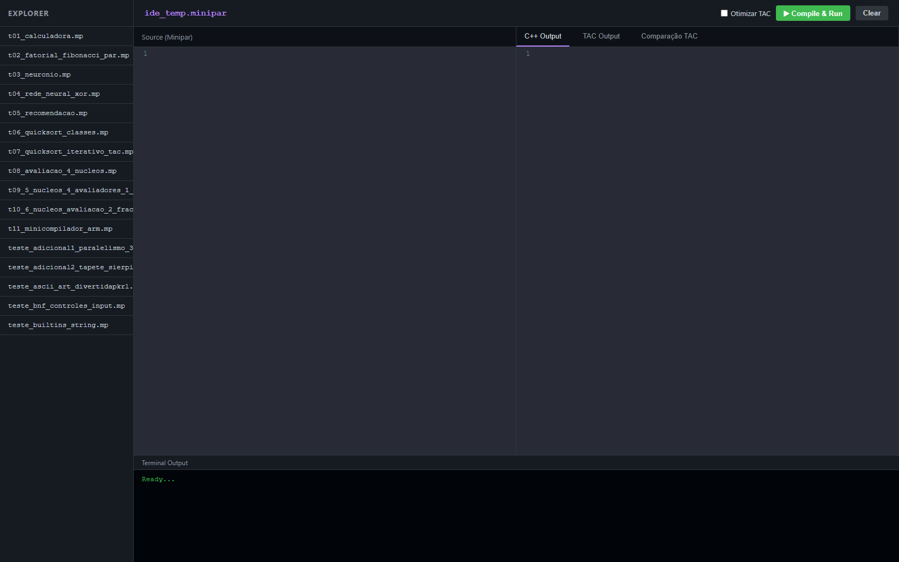
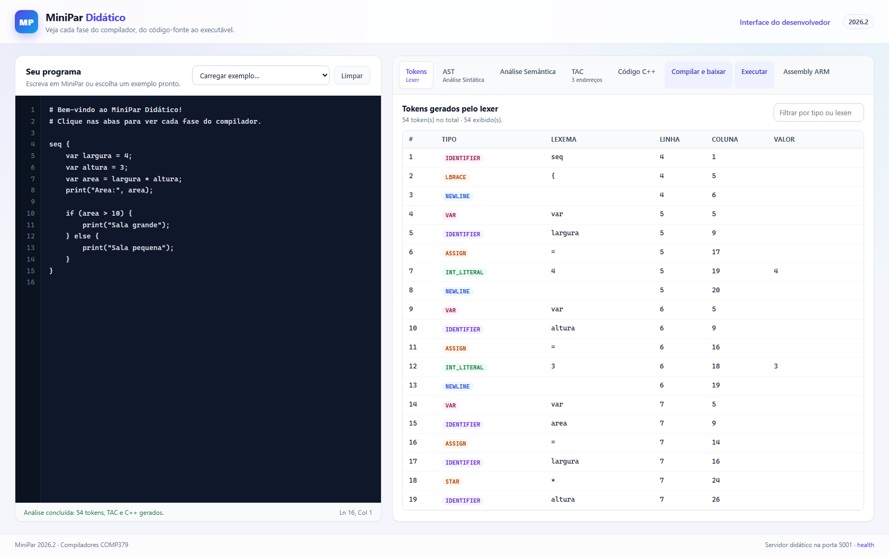
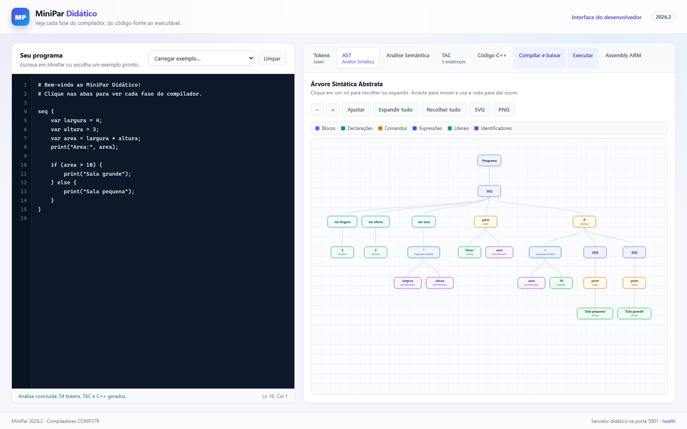
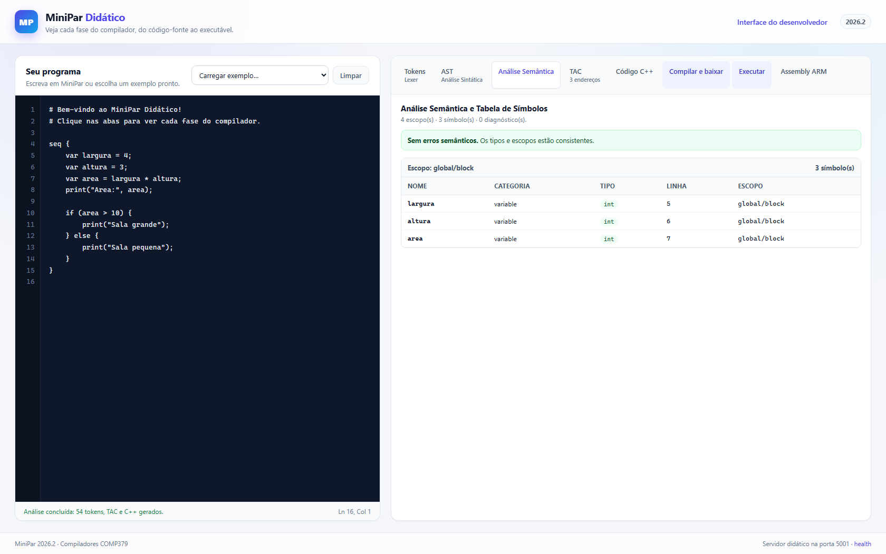
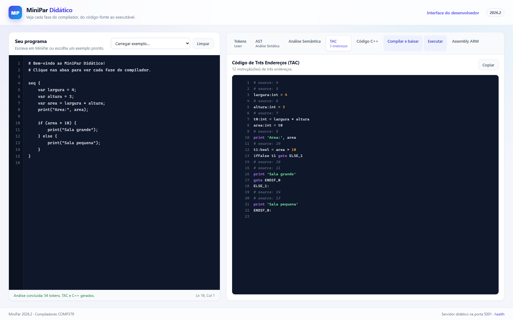
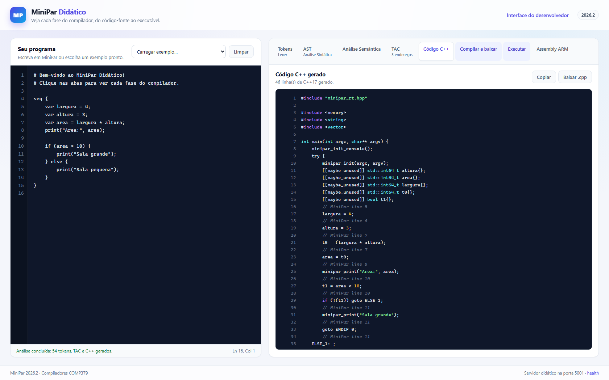
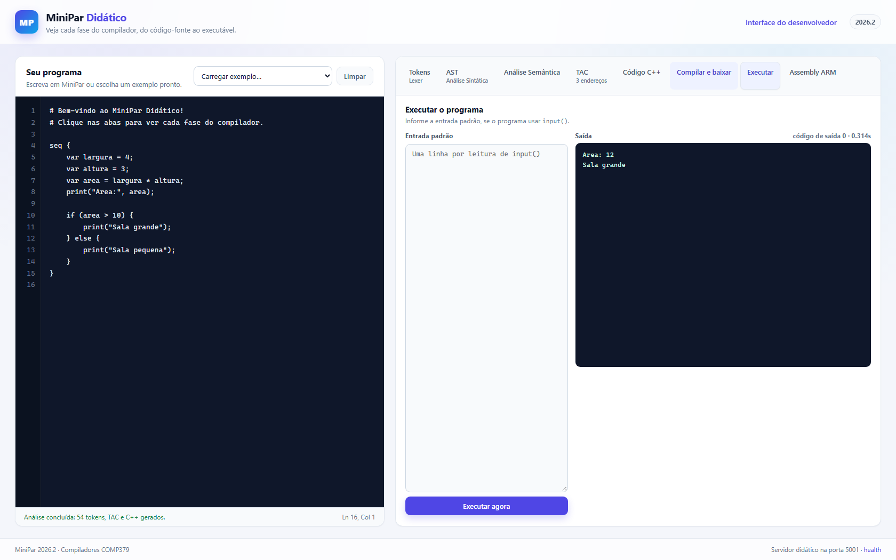
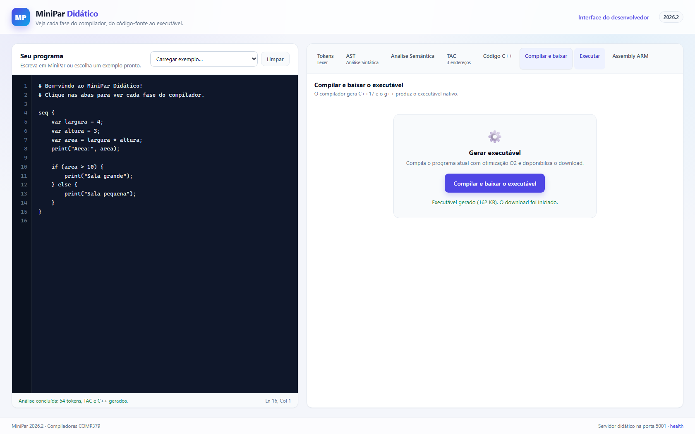
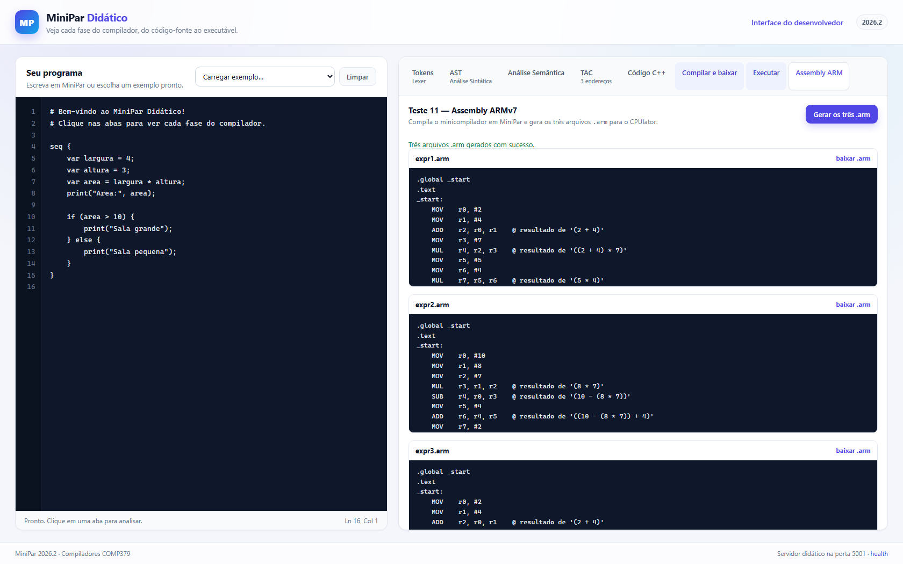

# Relatório do Compilador MiniPar 2026.2

**Disciplina:** Compiladores — COMP379  
**Professor:** Arturo Hernández Domínguez  
**Equipe:** João Victor Duarte do Nascimento, Rian Antonio da Silva Gaião, José Guilherme de Almeida Novais, Daniel de Araujo Albuquerque, Guilherme Alessander da Silva Fernandes  
**Data de entrega:** 11/11/2026  
**Reavaliação:** 25/11/2026 · **Final:** 02/12/2026  
**Repositório:** <https://github.com/johnUFAL/minipar-improvement>  
**Interface de referência:** <http://pesquisa06.lages.ifsc.edu.br/>

---

## Sumário

1. [Introdução](#1-introdução)
2. [Visão geral e arquitetura de componentes](#2-visão-geral-e-arquitetura-de-componentes)
3. [Linguagem MiniPar 2026.2](#3-linguagem-minipar-20262)
4. [Análise léxica](#4-análise-léxica)
5. [Análise sintática e AST](#5-análise-sintática-e-ast)
6. [Análise semântica e tabela de símbolos](#6-análise-semântica-e-tabela-de-símbolos)
7. [Tratamento de erros](#7-tratamento-de-erros)
8. [Geração de TAC](#8-geração-de-tac)
9. [Geração de código C++ e runtime](#9-geração-de-código-c-e-runtime)
10. [Interfaces](#10-interfaces)
11. [Testes 1 a 7](#11-testes-1-a-7)
12. [Testes 8 a 10 — fork/join em núcleos de CPU](#12-testes-8-a-10--forkjoin-em-núcleos-de-cpu)
13. [Teste 11 — minicompilador com Assembly ARMv7](#13-teste-11--minicompilador-com-assembly-armv7)
14. [Testes unitários e de integração](#14-testes-unitários-e-de-integração)
15. [Product backlog e sprint backlog](#15-product-backlog-e-sprint-backlog)
16. [Modelagem UML](#16-modelagem-uml)
17. [Tecnologias e ambiente](#17-tecnologias-e-ambiente)
18. [Como executar](#18-como-executar)
19. [Limitações e trabalhos futuros](#19-limitações-e-trabalhos-futuros)
20. [Referências](#20-referências)

---

## 1. Introdução

O MiniPar é uma linguagem didática, orientada a objetos, com blocos
sequenciais (`seq`), paralelos (`par`), tarefas `fork`/`join` e canais
`c_channel`. O compilador foi construído em Python com uma arquitetura de
componentes de software: cada fase é um componente com interface própria,
orquestrado pelo componente de controle.

A versão 2026.2 amplia o compilador em quatro frentes:

1. **Testes 8, 9 e 10** — algoritmos paralelos reais, com alocação explícita em
   núcleos de CPU (`fork tarefa em core(n)`), fractais ASCII e benchmark de
   speedup.
2. **Teste 11** — um minicompilador de expressões infixadas escrito **em
   MiniPar**, que gera Assembly ARMv7 e grava arquivos `.arm` prontos para o
   CPUlator.
3. **Segunda interface Web didática** — voltada a alunos iniciantes, com abas
   para cada fase, AST em SVG interativa e download do executável.
4. **Atualização da linguagem** — literal de caractere, tipo `char`, builtins de
   string/arquivo e suporte a `matrix`.

O pipeline completo é:

```text
fonte .mp
   │
   ▼
[Lexer] ──► tokens
   │
   ▼
[Parser] ──► AST
   │
   ▼
[Semântico + Tabela de Símbolos]
   │
   ▼
[Gerador TAC] ──► .tac
   │
   ▼
[Gerador C++17] ──► .cpp
   │
   ▼
[Driver g++ 16.2] ──► executável nativo
   │
   ▼
[Runtime] ──► threads, canais TCP, fork/join, worker remoto
```

---

## 2. Visão geral e arquitetura de componentes

| Componente | Arquivo | Responsabilidade |
|---|---|---|
| Léxico | `components/lexico/c_lexico.py` | tokens, strings, caracteres, comentários |
| Sintático | `components/sintatico/c_sintatico.py` | parser descendente recursivo, AST |
| AST | `components/sintatico/ast.py` | nós imutáveis (`dataclass`) e `para_dict()` |
| Semântico | `components/semantico/c_semantico.py` | tipos, escopos, builtins, diagnósticos |
| Tabela de Símbolos | `components/tabela_simbolos/c_tabela_simbolos.py` | símbolos por escopo e exportação |
| TAC | `components/tac/c_gerador_tac.py` | código de três endereços |
| Otimizador TAC | `components/tac/otimizador_tac.py` | dobramento e propagação |
| Codegen C++ | `components/codegen/c_gerador_cpp.py` | tradução TAC → C++17 |
| Driver GCC | `components/codegen/driver_gcc.py` | compilação, link e execução |
| Controle | `components/controle/c_controle.py` | ordem das fases |
| Runtime | `runtime/minipar_rt.hpp`, `paralelo.cpp`, `canal.cpp`, `worker.cpp` | builtins, threads, canais, remoto |
| Web 1 | `interfaces/web/` | IDE do desenvolvedor (porta 5000) |
| Web 2 | `interfaces/web2/` | interface didática (porta 5001) |

O diagrama de componentes está em
[`docs/uml/componentes.puml`](../uml/componentes.puml) e a modelagem da nova
interface em [`docs/uml/web2_componentes.puml`](../uml/web2_componentes.puml).

---

## 3. Linguagem MiniPar 2026.2

### 3.1 Tipos

`bool`, `int`, `float`, `string`, `char`, `list`, `void` e classes do usuário.
`char` é um tipo próprio na AST e no semântico, mas o backend C++ o representa
como `std::string` de um caractere, o que uniformiza indexação, concatenação e
comparação.

### 3.2 Sintaxe resumida

```minipar
seq {
    var nome = "MiniPar";
    var letra: char = 'M';
    var area = 4 * 3;

    if (area > 10) {
        print("Sala grande:", area);
    } elif (area == 10) {
        print("Sala exata");
    } else {
        print("Sala pequena");
    }

    fork avaliador em core(1) {
        print("tarefa no nucleo 1");
    }
    join avaliador
}
```

### 3.3 Builtins principais

| Builtin | Assinatura | Retorno |
|---|---|---|
| `char_at(texto, i)` | `string, int` | `char` |
| `substring(texto, inicio, fim)` | `string, int, int` | `string` (fim exclusivo) |
| `is_digit(c)` / `is_alpha(c)` / `is_space(c)` | `string`/`char` | `bool` |
| `is_number(s)` | `string` | `bool` |
| `write_file(caminho, conteudo)` | `string, string` | `int` (0 = sucesso) |
| `random_uniforme(min, max)` | `float, float` | `float` |
| `clock()` / `agora()` | — | `float` (segundos) |
| `format_float(x, casas)` | `float, int` | `string` |
| `matrix(linhas, colunas, valor)` | `int, int, var` | `list` |

A gramática completa está em [`docs/gramatica.md`](../gramatica.md).

---

## 4. Análise léxica

O lexer percorre a fonte caractere a caractere, mantendo linha e coluna,
reconhecendo palavras reservadas, identificadores, números, strings, caracteres,
operadores e comentários (`#` até o fim da linha). Ele também trata quebras de
linha e delimitadores, permitindo blocos com `{ }` e `;`.

### 4.1 Pseudocódigo

```text
função tokenizar(fonte):
    pos ← 0; linha ← 1; coluna ← 1
    enquanto pos < tamanho(fonte):
        c ← fonte[pos]
        se c é espaço: avança
        senão se c é dígito:
            lê dígitos e, opcionalmente, '.' seguido de dígitos
            emite INT_LITERAL ou FLOAT_LITERAL
        senão se c é letra ou '_':
            lê letra/dígito/'_'
            emite palavra reservada ou IDENTIFIER
        senão se c == '"':
            lê até '"' tratando \n, \t, \\, \"
            emite STRING_LITERAL
        senão se c == '\'':
            lê exatamente um caractere (ou escape)
            emite CHAR_LITERAL
        senão se c == '#':
            descarta até o fim da linha
        senão:
            emite operador/delimitador correspondente
    emite END_OF_FILE
```

### 4.2 Decisões

- `char` aceita `'a'`, `'\n'`, `'\t'`, `'\\'` e `'\''`; zero ou dois caracteres
  geram erro léxico com linha e coluna.
- Strings não fechadas e escapes inválidos geram diagnóstico, mas o lexer
  continua para reportar mais de um erro por execução.
- A indentação por espaços é aceita; a forma principal dos programas 2026.2 usa
  chaves, o que simplifica blocos e `fork`.

---

## 5. Análise sintática e AST

O parser é descendente recursivo, com um não-terminal por nível de precedência:

```text
or < and < not < comparação < + - < * / % < unário < postfixo (() . [])
```

### 5.1 Pseudocódigo do parser de expressões

```text
parse_expr():
    node ← parse_termo()
    enquanto token atual é '+' ou '-':
        op ← consome
        direita ← parse_termo()
        node ← BinaryExpr(op, node, direita)
    retorna node

parse_termo():
    node ← parse_fator()
    enquanto token atual é '*' ou '/':
        op ← consome
        direita ← parse_fator()
        node ← BinaryExpr(op, node, direita)
    retorna node

parse_fator():
    se token é '(':
        consome '('
        node ← parse_expr()
        consome ')'
        retorna node
    se token é número/string/char/bool:
        retorna literal
    se token é identificador:
        retorna IdentifierExpr ou chamada
    se token é 'new':
        retorna NewExpr
```

### 5.2 AST

Os nós são `dataclass` imutáveis e cada um implementa `para_dict()`, usado pela
API e pela interface didática. A AST é a fonte única para o semântico, o TAC e o
codegen; nenhuma fase posterior reinterpreta o texto-fonte.

A segunda interface converte o dicionário em uma árvore visual: cada nó recebe
uma categoria (bloco, declaração, comando, expressão, literal, identificador),
uma cor e um tooltip com linha, coluna e tipo inferido. O layout é calculado no
navegador e desenhado em SVG.

---

## 6. Análise semântica e tabela de símbolos

O analisador semântico coleta primeiro funções e classes (permitindo recursão e
referências posteriores), depois valida corpos, tipos e escopos.

### 6.1 Pseudocódigo

```text
analisar(programa):
    coleta funções, classes, canais e assinaturas
    para cada declaração:
        abre escopo se for bloco/classe/função
        valida instruções:
            VarDecl → infere tipo da expressão e registra símbolo
            Assignment → verifica existência e compatibilidade
            If/While/For → condição deve ser bool
            Call → verifica aridade e tipos dos argumentos
            Fork → abre escopo próprio; escrita em variável externa é erro
            Join → exige fork anterior no mesmo escopo
        fecha escopo
    se houver erros: retorna falso
```

### 6.2 Regras principais

- `int` promove para `float`; `float` para `int` exige `int(...)`.
- `/` sempre produz `float`.
- `char` e `string` são compatíveis; indexar string produz `char`.
- Condições devem ser `bool`.
- `fork`/`par` não podem escrever em variáveis externas; resultados remotos são
  devolvidos pelo `join` no caso de `host`.
- `send`/`receive` exigem canal declarado e aridade/tipos consistentes.
- Todo `fork` deve ter `join` no mesmo escopo.

### 6.3 Tabela de símbolos

Cada símbolo guarda nome, categoria, tipo, escopo, linha, assinatura, parâmetros
e, para classes, atributos e métodos. A exportação é usada pelas duas interfaces
Web. O pseudocódigo detalhado está em
[`docs/pseudocodigo_tabela_simbolos.md`](../pseudocodigo_tabela_simbolos.md).

---

## 7. Tratamento de erros

Os diagnósticos têm fase, severidade, mensagem, linha, coluna e comprimento. O
`DiagnosticBag` acumula erros para mostrar vários de uma vez e formata um trecho
da linha com um marcador `^`.

Exemplo:

```text
erro sintático [48:27]: Esperada quebra de linha após ':'
  48 |     fork prof em core(1): {
     |                           ^
```

Na interface didática, os erros aparecem em um painel vermelho; clicar em um
diagnóstico leva o cursor à linha correspondente, e a numeração lateral destaca
as linhas com erro.

---

## 8. Geração de TAC

O TAC usa temporários `t0, t1, …`, rótulos e instruções explícitas para
controle de fluxo e concorrência.

Exemplo para `((2+4)*7)-(5*4)`:

```text
t1 = 2 + 4
t2 = t1 * 7
t3 = 5 * 4
t4 = t2 - t3
```

Instruções de apoio: `goto`, `ifFalse`, `print`, `param`, `call`, `ret`,
`fork`, `join`, `par_begin`, `par_end`, `send`, `recv`, `alloc`, `getfield`,
`setfield`, `array_at`, `array_set`.

O otimizador faz dobramento de constantes e propagação de cópias; a primeira
interface Web permite comparar o TAC original e o otimizado lado a lado.

---

## 9. Geração de código C++ e runtime

O gerador traduz o TAC para C++17 sem consultar a AST. Cada instrução vira uma
linha C++; variáveis e temporários recebem tipos inferidos. Builtins são
mapeados para o runtime (`__minipar_concat`, `__minipar_format_float`,
`__minipar_char_at`, `__minipar_write_file`, `random_val`, `agora` etc.).

O driver `DriverGCC` compila com:

```text
g++ -std=c++17 -Wall -O2 programa.cpp runtime/canal.cpp runtime/paralelo.cpp runtime/worker.cpp -I runtime -o programa
```

No Windows adiciona `-lws2_32`; no Linux adiciona `-pthread`. O executável é
gerado no diretório de saída e pode ser executado pelo driver ou diretamente.

### 9.1 Runtime paralelo

- `par { ... }`: cada filho direto vira uma thread.
- `fork t em core(n)`: thread com afinidade à n-ésima CPU permitida; se o índice
  não existir, o runtime avisa e executa sem afinidade.
- `fork t em host("pc2")`: tarefa remota via worker TCP.
- `c_channel`: comunicação TCP tipada, com timeout configurável.
- `MINIPAR_TRACE_CORES=1` registra em `stderr` a CPU em que cada tarefa rodou.

---

## 10. Interfaces

### 10.1 Terminal

A interface de terminal (`python main.py`, opção 1) permite escolher programas,
compilar, executar, inspecionar tokens/AST/TAC e rodar a suíte de testes. O
compilador também tem CLI:

```bash
python main.py compilar programa.mp --tokens
python main.py compilar programa.mp --ast
python main.py compilar programa.mp --tac
python main.py compilar programa.mp --emit-cpp
```

### 10.2 Primeira interface Web (desenvolvedor)

`python -m interfaces.web.api` — <http://127.0.0.1:5000>

Mantida como estava: editor CodeMirror, comparação de TAC original/otimizado,
execução, testes e orquestração de sessões multi-terminal.



### 10.3 Segunda interface Web (didática)

`python -m interfaces.web2.app` — <http://127.0.0.1:5001>  
Porta configurável por `MINIPAR_WEB2_PORT`.

A interface foi organizada como a referência do IFSC: barra superior, abas
horizontais, editor à esquerda e painel de saída à direita. Cada aba executa e
mostra uma fase:

| Aba / botão | O que mostra |
|---|---|
| **Tokens — Lexer** | tabela com tipo, lexema, linha, coluna e valor, com filtro |
| **AST — Análise Sintática** | árvore SVG com zoom, pan, recolhimento, tooltips, legenda e exportação SVG/PNG |
| **Análise Semântica** | diagnósticos e tabela de símbolos por escopo |
| **TAC — 3 endereços** | instruções numeradas e realçadas |
| **Código C++ gerado** | código C++17 com realce, cópia e download |
| **Compilar e baixar** | compila com g++ e baixa o executável |
| **Executar** | entrada padrão, stdout, stderr, código de saída e tempo |
| **Assembly ARM** | executa o Teste 11 e disponibiliza os três `.arm` |

















#### AST: decisões de visualização

- Nós coloridos por categoria, com legenda fixa.
- Rótulos didáticos: `var nome`, `func nome()`, operador no lugar de
  `BinaryExpr`, valor no lugar de `NumberExpr`.
- Detalhe secundário com tipo, operação ou alvo (`em core`, `extends`).
- Clique recolhe/expande; o número de filhos aparece em um badge.
- Zoom pela roda, pan por arraste, botão “Ajustar”, exportação SVG e PNG.
- Tooltip com linha, coluna, tipo inferido e quantidade de filhos.

---

## 11. Testes 1 a 7

| Teste | Arquivo | Conceitos | Situação |
|---|---|---|---|
| T1 | `t01_calculadora.mp` | canal, `send`/`receive`, condicionais | OK |
| T2 | `t02_fatorial_fibonacci_par.mp` | `par`, laços, fatorial e Fibonacci | OK |
| T3 | `t03_neuronio.mp` | classes, métodos, `new`, atributos | OK |
| T4 | `t04_rede_neural_xor.mp` | funções, listas, `exp`, laços aninhados | OK |
| T5 | `t05_recomendacao.mp` | herança, objetos, listas | OK |
| T6 | `t06_quicksort_classes.mp` | recursão, métodos, indexação | OK |
| T7 | `t07_quicksort_iterativo_tac.mp` | iteratividade, `continue`, TAC | OK |

Os testes adicionais (`teste_adicional1_paralelismo_3_computadores.mp`,
`teste_adicional2_tapete_sierpinski.mp`, `teste_bnf_controles_input.mp` e
`teste_builtins_string.mp`) também compilam e executam.

---

## 12. Testes 8 a 10 — fork/join em núcleos de CPU

Os três programas foram portados dos benchmarks Python para MiniPar. Cada
avaliador roda em um núcleo dedicado:

```minipar
fork prof em core(1) {
    var r = trabalhador_avaliacao("Professor", 0, 40);
}
fork mon1 em core(2) {
    var r = trabalhador_avaliacao("Monitor 1", 40, 40);
}
...
join prof, mon1, mon2, mon3
```

### 12.1 Teste 8 — 160 atividades em 4 núcleos

- 40 alunos × 4 atividades = 160 tarefas.
- Cada tarefa consome ciclos de CPU proporcionais a um tempo aleatório entre
  0,05 s e 0,15 s (LCG do runtime).
- O modo sequencial usa 1 núcleo; o paralelo usa 4.
- Saída: uma linha por avaliador, tempos, speedup e redução percentual.

Saída medida nesta máquina:

```text
Tempo Sequencial : 0.59 s
Tempo Paralelo   : 0.18 s
Aceleracao       : 3.33 x mais rapido!
Reducao no tempo : 70.0 % de economia
```

### 12.2 Teste 9 — 5 núcleos com Mandelbrot ASCII

Quatro núcleos corrigem as atividades e o quinto calcula o fractal de
Mandelbrot (50 × 20, 100 iterações) em ASCII.

```text
Tempo Sequencial : 0.54 s
Tempo Paralelo   : 0.16 s
Aceleracao       : 3.39 x mais rapido!
Reducao no tempo : 70.5 % de economia
```

### 12.3 Teste 10 — 6 núcleos com dois fractais

Quatro núcleos de avaliação, um para Mandelbrot e um para o tapete de
Sierpinski. O desenho do tapete usa a regra dos dígitos na base 3: uma célula é
vazia quando os dígitos correspondentes de `x` e `y` valem 1 ao mesmo tempo.
Essa formulação substitui o Turtle do original e evita listas aninhadas.

```text
Tempo Sequencial : 0.54 s
Tempo Paralelo   : 0.17 s
Aceleracao       : 3.25 x mais rapido!
Reducao no tempo : 69.2 % de economia
```

### 12.4 Observações sobre o benchmark

- A carga é CPU-bound e o número de núcleos disponíveis varia por máquina; em
  computadores com menos de 4 CPUs o speedup cai.
- `MINIPAR_TRACE_CORES=1` permite comprovar a CPU usada por cada tarefa.
- `host("...")` não foi usado nos benchmarks para manter a execução
  reprodutível; o caminho remoto é coberto por `test_fork_remoto.py`.
- As saídas completas estão em `docs/relatorio/resultados/t08_saida.txt`,
  `t09_saida.txt` e `t10_saida.txt`.

---

## 13. Teste 11 — minicompilador com Assembly ARMv7

### 13.1 Arquitetura da aplicação MiniPar

`programas_teste/t11_minicompilador_arm.mp` define a classe
`MiniCompiladorARM`, com:

| Método | Função |
|---|---|
| `tokenizar()` | imprime os tokens no formato do gabarito |
| `parse_expr()` / `parse_termo()` / `parse_fator()` | parser recursivo com precedência |
| `imprimir_ast(texto, nivel)` | AST rotacionada (direita → raiz → esquerda) |
| `gerar_tac(texto)` | TAC com temporários `t1, t2, …` |
| `gerar_arm(texto)` | Assembly ARMv7 com `MOV`, `ADD`, `SUB`, `MUL` |
| `avaliar(texto)` | resultado numérico |
| `imprimir_simbolos()` | tabela de símbolos (constantes ordenadas) |
| `executar(expressao, arquivo)` | fluxo completo e gravação do `.arm` |

A AST é representada como uma string parentetizada, por exemplo
`((2 + 4) * 7)`. Isso evita listas (cujo `append` ainda não é baixado pelo
codegen) e permite reconstruir a árvore em cada fase com `substring` e
`char_at`.

### 13.2 Expressões e resultados

| Expressão | Resultado |
|---|---|
| `((2+4)*7)-(5*4)` | `22.0` |
| `((10 -8*7)+4)*2` | `-84.0` |
| `((2+4)*7)-(5*4)` | `22.0` |

### 13.3 Assembly gerado para a primeira expressão

```asm
.global _start
.text
_start:
    MOV    r0, #2
    MOV    r1, #4
    ADD    r2, r0, r1    @ resultado de '(2 + 4)'
    MOV    r3, #7
    MUL    r4, r2, r3    @ resultado de '((2 + 4) * 7)'
    MOV    r5, #5
    MOV    r6, #4
    MUL    r7, r5, r6    @ resultado de '(5 * 4)'
    SUB    r8, r4, r7    @ resultado de '(((2 + 4) * 7) - (5 * 4))'
    b .    @ loop infinito para parar o programa
```

Esse texto é idêntico ao gabarito `Codigo-Assembly-ARMV7.arm.txt`. O programa
grava os três arquivos em `programas_teste/teste11/`:

- `expr1.arm` — `((2+4)*7)-(5*4)`;
- `expr2.arm` — `((10 -8*7)+4)*2`;
- `expr3.arm` — `((2+4)*7)-(5*4)`.

### 13.4 Validação

1. **clang (automática):**

   ```bash
   clang --target=armv7-none-eabi -x assembler -c programas_teste/teste11/expr1.arm -o expr1.o
   ```

   Os três arquivos montam sem erro (teste `test_arm_files_assemble_for_armv7_when_clang_is_available`).

2. **CPUlator (manual):**
   - abrir <https://cpulator.01xz.net/?sys=arm-de1soc>;
   - colar o conteúdo de `expr1.arm` no editor;
   - compilar e executar;
   - verificar `r8 = 22` (e `r8 = -84` para `expr2.arm`).

3. **Resultado textual:** a saída do programa contém `22.0`, `-84.0` e `22.0`,
   além de tokens, AST, TAC e tabela de símbolos. A saída completa está em
   `docs/relatorio/resultados/t11_saida.txt`.

### 13.5 Limitações

- O Assembly não implementa divisão, seguindo o gabarito Java
  (`@ divisão não suportada`). A avaliação numérica calcula `/` normalmente.
- O número de registradores é sequencial (`r0…rN`); expressões muito grandes
  podem ultrapassar os registradores disponíveis no CPUlator.
- A entrada é fixa no programa (as três expressões do enunciado), o que torna a
  execução reprodutível para a avaliação.

---

## 14. Testes unitários e de integração

### 14.1 Suíte completa

```text
226 passed, 1 skipped, 40 subtests passed in 252.26s
```

O único teste ignorado é o de `taskset`, específico de Linux.

### 14.2 Cobertura por área

| Área | Exemplos |
|---|---|
| Léxico | palavras reservadas, strings, `CHAR_LITERAL`, escapes, erros |
| Sintático | precedência, parênteses, classes, funções, `fork`/`join` |
| Semântico | tipos, escopos, builtins, `char`↔`string`, canais |
| TAC | temporários, chamadas, arrays, `fork`/`host` |
| Codegen | compilação C++ dos casos gerados, builtins, fork/core |
| Runtime | canais, threads, afinidade, worker remoto |
| Integração | T1–T11, `write_file`, interface Web 1 e Web 2 |

### 14.3 Testes novos em 2026.2

- `tests/unitarios/test_lexico.py` — `CharLiteralTests`.
- `tests/unitarios/test_semantico_basico.py` — tipos de retorno dos builtins e
  compatibilidade `char`/`string`.
- `tests/unitarios/test_codegen.py` — mapeamento de builtins e preservação de
  `fork`/`core`.
- `tests/integracao/test_builtins_string.py` — compila, executa e confere
  `write_file`.
- `tests/integracao/test_testes_8_11.py` — T8–T10 e T11 (resultados e `.arm`).
- `tests/integracao/test_web2.py` — endpoints, compilação, execução, download e
  arquivos `.arm`.

---

## 15. Product backlog e sprint backlog

### 15.1 Product backlog (recorte 2026.2)

| ID | Item | Prioridade | Situação |
|---|---|---|---|
| L1 | `char_at` no runtime, semântico e testes | P0 | Concluído |
| L2 | `substring` com fim exclusivo | P0 | Concluído |
| L3 | `is_digit`, `is_alpha`, `is_space`, `is_number` | P0 | Concluído |
| L4 | `write_file` | P0 | Concluído |
| L5 | Indexação de string → `char` | P0 | Concluído |
| L6 | Literal `'x'`, tipo `char`, BNF | P1 | Concluído |
| T8 | Teste 8 em MiniPar | P0 | Concluído |
| T9 | Teste 9 em MiniPar | P0 | Concluído |
| T10 | Teste 10 em MiniPar | P0 | Concluído |
| T11a | Lexer/parser/AST do T11 | P0 | Concluído |
| T11b | TAC/Assembly/avaliação | P0 | Concluído |
| T11c | Gravação dos `.arm` | P0 | Concluído |
| T11d | Validação no CPUlator | P0 | Pendente (manual) |
| W2a | Backend da segunda interface | P0 | Concluído |
| W2b | Abas e botões | P0 | Concluído |
| W2c | AST em SVG | P0 | Concluído |
| W2d | Download do `.exe` e `.arm` | P0 | Concluído |
| D1 | BNF atualizada | P0 | Concluído |
| D2 | README/backlog | P1 | Concluído |
| D3 | UML | P0 | Parcial |
| D4 | Relatório | P0 | Este documento |
| D5 | Slides | P0 | Ver `APRESENTACAO-2026.2.md` |
| V1 | Suíte completa | P0 | Concluído |
| V2 | Teste remoto | P1 | Coberto por teste automatizado localhost |
| V3 | Screenshots | P0 | Concluído |

### 15.2 Sprint backlog (06–11/11)

| Dia | Entrega |
|---|---|
| 06/11 | Fase 1: builtins, `char`, testes |
| 07/11 | T8 e T9 |
| 08/11 | T10 |
| 09/11 | T11 e `.arm` |
| 10/11 | Segunda interface Web |
| 11/11 | Documentação, relatório, apresentação e entrega |

---

## 16. Modelagem UML

Os diagramas PlantUML estão em `docs/uml/`:

- `componentes.puml` — componentes do compilador;
- `web2_componentes.puml` — navegador, Flask, serviço e pipeline;
- `classes.puml` — classes principais;
- `casos_de_uso.puml` — casos de uso;
- `ast_*.puml` — famílias de nós da AST;
- `tac_planejado.puml` e `tac_runtime.puml` — TAC e runtime.

Para regenerar os PNGs:

```bash
plantuml -tpng docs/uml/*.puml
```

---

## 17. Tecnologias e ambiente

| Item | Versão / configuração |
|---|---|
| Python | 3.11.15 |
| Flask | 3.1.3 |
| GCC / g++ | 16.2.0 (MSYS2 UCRT64) |
| `CXX` | `C:\msys64\ucrt64\bin\g++.exe` |
| clang | 23.1.4 (validação ARMv7) |
| Sistema | Windows 10 (build 26300) |
| Editor Web 2 | HTML/CSS/JavaScript puro, SVG nativo |
| Testes | pytest, unittest, subtests |

O `PATH` da máquina foi ajustado para colocar `C:\msys64\ucrt64\bin` antes de
`C:\MinGW\bin`, garantindo que o g++ 16.2 seja usado pelo driver.

---

## 18. Como executar

```bash
# instalar dependências
uv sync --extra dev

# suíte completa
uv run pytest -q

# terminal
python main.py

# Web 1 (desenvolvedor)
python -m interfaces.web.api          # http://127.0.0.1:5000

# Web 2 (didática)
python -m interfaces.web2.app         # http://127.0.0.1:5001
# outra porta:
set MINIPAR_WEB2_PORT=5010 && python -m interfaces.web2.app

# Testes 8–10
python main.py compilar programas_teste/t08_avaliacao_4_nucleos.mp -O2 -o t08 --executar
python main.py compilar programas_teste/t09_5_nucleos_4_avaliadores_1_fractal.mp -O2 -o t09 --executar
python main.py compilar programas_teste/t10_6_nucleos_avaliacao_2_fractais.mp -O2 -o t10 --executar

# Teste 11
python main.py compilar programas_teste/t11_minicompilador_arm.mp -O0 -o t11 --executar
```

---

## 19. Limitações e trabalhos futuros

1. `list.append`, `string.split` e `string.strip` são aceitos pelo semântico,
   mas ainda não são baixados para TAC/C++. O Teste 11 evita listas.
2. A inferência de tipos de listas aninhadas é limitada; `matrix(...)` é
   mapeado no codegen, mas o T10 usa a regra dos dígitos base 3.
3. O Assembly do Teste 11 não implementa divisão e usa registradores
   sequenciais, seguindo o gabarito Java.
4. A validação no CPUlator é manual; a validação automática usa `clang`.
5. A execução remota real com dois computadores é coberta por teste local com
   workers em `localhost`; a demonstração em laboratório fica para a
   reavaliação.
6. A interface didática não persiste programas no servidor; o download do
   executável expira em uma hora.

---

## 20. Referências

- PDF do projeto: `Projeto-Compilador-MiniPar2026-2-Atualizado.pdf`.
- BNF 2026.1: `BNF-grammaMiniPAR2026-1.md`.
- Relatório 2026.1: `RelatorioMinipar2026-1-Compilador-GeracaoCodigoExe-10,0-okokok.pdf`.
- Gabaritos do Teste 11: `MiniCompiladorCompleto_ARMv7.java.txt`,
  `Codigo-Assembly-ARMV7.arm.txt`, `Execucao-Saida-okRodounoCPULATOR.txt`.
- Interface de referência: <http://pesquisa06.lages.ifsc.edu.br/>.
- Repositório 2026.1: <https://github.com/luizwhirl/minipar-improvement>.
- CPUlator: <https://cpulator.01xz.net/?sys=arm-de1soc>.

---

## Apêndice A — Checklist de entrega

- [x] T1–T7 compilam e executam.
- [x] T8–T10 em MiniPar compilam, executam e mostram benchmark.
- [x] T11 em MiniPar compila, executa e gera os três `.arm`.
- [x] Os três `.arm` montam para ARMv7 com `clang`.
- [ ] Os três `.arm` executados no CPUlator com screenshots (manual).
- [x] Segunda interface Web funciona com todos os botões.
- [x] AST da segunda interface é visualmente superior às anteriores.
- [x] Primeira interface Web e terminal continuam funcionando.
- [x] BNF atualizada em `docs/gramatica.md`.
- [x] README atualizado.
- [x] UML de componentes da Web 2 adicionada.
- [x] Relatório e roteiro de apresentação.
- [x] Screenshots das telas.
- [x] Suíte `pytest -q` verde (226 passed, 1 skipped).
- [ ] Código e relatório publicados no GitHub (commit/push).
